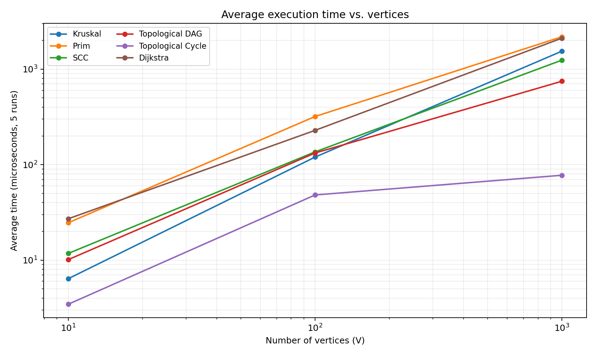
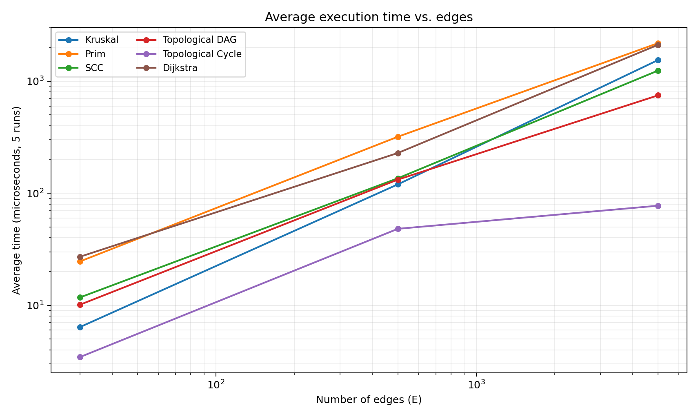

# Assignment 3 — Smart City Infrastructure and Route Planning

## Overview

This Java program models a city as a graph. Districts are vertices, roads are edges, and weights represent construction costs or travel distances.

Open the `assignment-3` folder in IntelliJ IDEA, mark `src` as Sources Root, and run `Main.java`, or from the project directory run:

```bash
javac -d out src/*.java
java -cp out Main
```

The program runs correctness tests first, shows a small example and prints benchmark results in CSV format.

## Implementation

All Java files are directly in `src` without package folders: `Graph.java` (with nested `Edge` and `Result` classes), `DSU.java`, `MST.java`, `Connectivity.java`, `ShortestPath.java`, and `Main.java`. `Main.java` contains the graph generation, tests, benchmarks, and entry point. 
- **DSU:** `find` uses path compression and `union` merges the smaller set into the larger set.
- **Kruskal:** sorts edges by weight and adds an edge when DSU says it does not make a cycle.
- **Prim:** uses a priority queue to choose the cheapest edge leading to an unvisited vertex. It finds a minimum spanning forest on disconnected graphs.
- **Topological ordering:** Kahn's algorithm uses indegrees and a queue. A missing full order indicates a directed cycle.
- **SCC:** Kosaraju's algorithm makes a DFS finish order, reverses the graph, then searches it again to identify components.
- **Dijkstra:** uses a priority queue and tracks distances and previous vertices to reconstruct paths. Negative weights are rejected; unreachable vertices retain an infinite distance.


## Complexity Analysis

Here, V means vertices, E means edges, and α(V) is the extremely slowly growing inverse Ackermann function.

| Algorithm | Time complexity | Extra space | Reason |
|---|---|---|---|
| DSU `find` / `union` | Amortized O(α(V)) per operation | O(V) | Path compression and union by size keep trees shallow |
| Kruskal | O(E log E + Eα(V)) = O(E log E) | O(V+E) | Sort edges, then DSU checks |
| Prim, lazy priority queue | O(E log E) | O(V+E) | An edge can be added to the binary heap before a vertex is visited |
| Kosaraju SCC | O(V+E) | O(V+E) | Two DFS passes and the reverse graph |
| Topological ordering, Kahn | O(V+E) | O(V) | Count indegrees, then process each vertex and edge |
| Dijkstra, lazy priority queue | O((V+E) log(E+1)) | O(V+E) | Heap updates may add multiple entries per vertex |

The graph itself uses O(V+E) adjacency-list space. Heap operations use the standard Java `PriorityQueue`. DSU with no optimizations can form long trees; path compression shortens repeated finds and union by size avoids unnecessarily increasing tree depth.

## Experimental Setup

| Graph size | V | E |
|---|---:|---:|
| Small | 10 | 30 |
| Medium | 100 | 500 |
| Large | 1000 | 5000 |

A fixed `java.util.Random` seed makes each input graph reproducible:

- Undirected MST graphs use seed `42+V`; they begin with the chain 0–1–2–…–(V−1), guaranteeing connectivity, before unique random edges are added.
- Directed cyclic graphs use seed `142+V`; they begin with the chain 0→1→…→(V−1), plus 2→0, so a cycle exists and all vertices are reachable from source 0. Remaining directed edges are random and unique.
- Directed DAGs use seed `242+V`; all randomly generated edges point from a smaller vertex number to a larger one, so cycles are impossible.
- Weights are random integers from 1 to 20. Duplicate weights are allowed, but duplicate edges and self-loops are not used in the generated test data.

Each applicable algorithm is run at all three sizes. Each timed experiment has **one warm-up run and five measured runs** on the same generated graph. `System.nanoTime()` measures each run; the reported average is in microseconds (μs).Timing is machine-dependent and can change between runs.

Operations count edge examinations, priority-queue or sorting comparisons, DSU operations, and other relevant queue operations. The CSV has separate `EdgeChecks`, `Comparisons`, and `DSUOps` columns. `DSUOps` counts `find` calls (including recursive calls) and `union` calls. Operation types have different costs, so counts are most meaningful when comparing the same algorithm across sizes.

## Results

### Average execution time (microseconds, 5 runs)

| Algorithm | 10 vertices / 30 edges | 100 vertices / 500 edges | 1000 vertices / 5000 edges |
|---|---:|---:|---:|
| Kruskal | 6.39 | 120.00 | 1544.34 |
| Prim | 24.62 | 319.35 | 2185.28 |
| SCC | 11.75 | 136.03 | 1243.39 |
| Topological DAG | 10.12 | 132.35 | 747.61 |
| Topological Cycle | 3.45 | 48.14 | 77.41 |
| Dijkstra | 27.11 | 228.64 | 2112.48 |

### Operation counts

| Algorithm | 10 vertices / 30 edges | 100 vertices / 500 edges | 1000 vertices / 5000 edges |
|---|---:|---:|---:|
| Kruskal | 148 | 4673 | 59135 |
| Prim | 292 | 9049 | 121982 |
| SCC | 90 | 1500 | 15000 |
| Topological DAG | 70 | 1100 | 11000 |
| Topological Cycle | 30 | 500 | 5000 |
| Dijkstra | 80 | 2155 | 29576 |

All individual measurements and operation categories are in [results/tables/benchmark.csv](results/tables/benchmark.csv).

### Execution time vs vertices



### Execution time vs edges




## Comparison and Discussion

Kruskal and Prim produced identical total MST weights on every connected undirected test graph. In this measured run, Kruskal took 1544.34 μs and Prim took 2185.28 μs on the largest graph. This lazy Prim implementation performs more priority-queue comparisons because it inserts candidate edges; this does not mean Kruskal is always faster on other graphs or computers.

The SCC traversal examines approximately three copies of the edge set: once in the first DFS, once during graph reversal, and once during the second DFS. Its operation count rises from 90 to 15000, matching its linear O(V+E) traversal structure.

Topological sorting returned a valid order for every DAG and no order for every cyclic benchmark. The cyclic case is unusually fast here because the deliberately inserted cycle leaves the initial queue empty. It therefore scans indegrees and detects that an ordering is impossible without processing all edges a second time.

Dijkstra's average measured time grew from 27.11 μs to 2112.48 μs as graphs grew. Its heap-comparison count also increased as the priority queue handled more candidate routes. Dijkstra requires nonnegative edge weights: a negative edge can make a supposedly shortest route shorter later, breaking the greedy assumption.

Kruskal uses DSU to prevent cycles, while Prim grows a connected region. Both are suitable for minimum-cost road construction. Topological ordering is useful when services must be installed in dependency order; SCC identifies circular one-way connections or dependencies; Dijkstra finds efficient nonnegative-distance routes. Measured timing differences also reflect JVM warm-up, heap allocation, and system load, so single-machine results should not be treated as universal rankings.

## Testing

The program runs automated checks before any benchmarks and prints `Tests: PASS` only if all succeed:

| Case | Expected check |
|---|---|
| Small weighted connected graph | Both MST totals are 6 |
| Disconnected graph | Both algorithms report disconnected and forest cost 5 |
| Duplicate edge weights and multiple MSTs | Both MST totals are 2 |
| Directed graph with a cycle | No topological order; one SCC in a three-vertex cycle |
| Directed acyclic graph | Every edge points forward in the returned order |
| Multiple SCCs | Three SCCs; each of five vertices belongs to exactly one component |
| Unreachable destination | Dijkstra returns an unreachable result |
| Known shortest path | Distance 0→2 is 5 using path [0, 1, 2] |
| Negative edge | Dijkstra rejects it |
| Single-vertex graph | MST weight 0; valid topological order, SCC, and distance |
| All three generated sizes | Kruskal=Prim weights, valid DAG orders, cycle detection, full SCC membership |

## Conclusion
The experiments show higher time and operation counts as graphs grow сonsistent with the stated complexity classes while actual performance depends on implementation and hardware.

